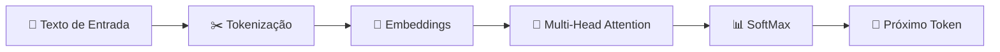

<div align="center">

# 📘 Guia Definitivo de IA Generativa & Assistentes de Código

**Arquitetura Transformer · Engenharia de Prompt (4 Personas) · Workflow de Alta Performance**


**Autor:** Lorison Gilles ([@Gill3s0x01](https://github.com/Gilles0x01)) · Tech Lead

</div>

---

## 📑 Sumário

1. [Contexto Técnico: Como os LLMs Enxergam o Seu Prompt](#-1-contexto-técnico-como-os-llms-enxergam-o-seu-prompt)
2. [As 4 Personas de Prompting](#-2-as-4-personas-de-prompting-para-qualquer-ia)
3. [Gestão de Contexto e Cota no Terminal](#-3-gestão-de-contexto-e-cota-em-assistentes-de-código-no-terminal)
4. [As 5 Regras de Ouro](#-4-as-5-regras-de-ouro-para-assistentes-de-código)
5. [Tabela Resumo de Comandos](#-5-tabela-resumo-de-comandos-e-boas-práticas)

---

## 🧠 1. Contexto Técnico: Como os LLMs Enxergam o Seu Prompt

Modelos de Linguagem de Grande Porte (**LLMs — Large Language Models**) baseados na arquitetura **Transformer** não leem nem interpretam textos da forma que humanos fazem. Eles processam representações vetoriais em espaços multidimensionais e calculam probabilidade estatística contínua para prever o próximo token.



### Princípios da Arquitetura Generativa

| Etapa | O que acontece |
|---|---|
| **Tokenização** | O texto do usuário é fragmentado em pedaços de palavras ou caracteres (tokens), recebendo identificadores numéricos únicos no vocabulário do modelo. |
| **Embeddings** | Esses IDs são convertidos em vetores multidimensionais. Palavras e conceitos semanticamente próximos ocupam coordenadas geométricas vizinhas no espaço vetorial. |
| **Multi-Head Attention** | O modelo avalia como cada token se relaciona com todos os outros tokens da janela de contexto. O último token da sequência possui o maior peso relacional imediato. |
| **SoftMax & Temperatura** | A rede confronta a matriz final com o vocabulário e gera uma distribuição de probabilidade. A **Temperatura** controla se o modelo escolhe tokens de altíssima certeza (baixa) ou arrisca opções mais criativas (alta). |

---

## 🎭 2. As 4 Personas de Prompting para Qualquer IA

Para extrair máxima performance e controle sobre qualquer modelo generativo (Claude, ChatGPT, Gemini), utilizamos 4 personas de prompting que direcionam a forma como as matrizes internas filtram e relacionam a informação.

<table>
<tr>
<td width="50%" valign="top">

### 🟠 01. CAVEMAN — *O Primitivo*


**Conceito:** Comunicação direta, sucinta e sem rodeios.

```text
> Refatora a função validarCPF() no arquivo valida.ts
```

**Mecânica da IA:** Fornece poucos tokens para a camada de Atenção, fazendo o modelo recorrer rapidamente aos padrões genéricos do conhecimento pré-treinado (Feed Forward).

**Uso ideal:** Dúvidas pontuais de sintaxe, correções rápidas, refatoração de funções isoladas.

</td>
<td width="50%" valign="top">

### 🟣 02. PONYTAIL — *O Estruturado*


**Conceito:** Foco rigoroso na forma e na estrutura do resultado exigido.

```text
> Saída estrita: JSON contendo as chaves
  { status: boolean, dados: array, erro: string | null }.
```

**Mecânica da IA:** Restringe a amostragem do SoftMax, penalizando tokens de texto conversacional fora da estrutura declarada.

**Uso ideal:** Integração entre sistemas (APIs), extração de dados, arquivos de configuração, DTOs e tabelas.

</td>
</tr>
<tr>
<td width="50%" valign="top">

### 🟢 03. RTK — *Contexto Rico / Real Time Knowledge*


**Conceito:** Injeção maciça de contexto, documentação, código-fonte ou regras de negócio antes da solicitação principal.

```text
> Com base na documentação oficial anexada e nas diretrizes
  de UI do projeto, construa o componente de tabela com ordenação.
```

**Mecânica da IA:** Ancora a atenção do modelo estritamente na base de conhecimento fornecida.

**Uso ideal:** Arquitetura de software, Spec-Driven Development, análise de código legado e compliance.

</td>
<td width="50%" valign="top">

### 🩷 04. ADHD — *O Hiperativo / Criativo*


**Conceito:** Pensamento lateral, simulação de papéis antagônicos, cenários hipotéticos e analogias.

```text
> Atue como um especialista em Red Team tentando burlar a
  validação do formulário e enumere os vetores de ataque possíveis.
```

**Mecânica da IA:** Amplia a variabilidade nas rotas de atenção, ativando combinações estatísticas não óbvias.

**Uso ideal:** Testes de estresse, Threat Modeling, ideação e desafios de arquitetura complexos.

</td>
</tr>
</table>

### ⚗️ A Fórmula da Fusão — *O Prompt Perfeito*

O nível avançado de Engenharia de Prompt consiste em combinar as 4 personas em uma única estrutura de mensagem:

```markdown
## 🟢 [RTK] CONTEXTO DE NEGÓCIO E ARQUITETURA
Sistema web em Vue 3 + Pinia + TypeScript com foco em alta concorrência.

## 🩷 [ADHD] PAPEL E PERSPECTIVA
Pense como um arquiteto focado em performance e segurança de dados.

## 🟠 [CAVEMAN] INSTRUÇÃO DIRETA
Identifique gargalos de reatividade na store userStore.ts e corrija.

## 🟣 [PONYTAIL] FORMATO DE SAÍDA
Retorne uma tabela em Markdown com: Linha | Problema | Correção Proposta.
```

---

## 💻 3. Gestão de Contexto e Cota em Assistentes de Código no Terminal

Em assistentes de código de linha de comando (como **Claude Code**, **Cursor CLI** ou **GitHub Copilot CLI**), um problema frequente é o esgotamento rápido das cotas de uso da API.

### ❄️ O Diagnóstico: O Efeito Bola de Neve no Contexto

A cada novo prompt digitado na mesma sessão, a ferramenta reenvia **todo o histórico anterior** da conversa (mensagens passadas, arquivos lidos, ferramentas acionadas) para a API da IA.

```text
1ª Tarefa: [ Input Sistema + Prompt 1 ] --------------------> 15.000 tokens
2ª Tarefa: [ Input + Prompt 1 + Resposta 1 + Prompt 2 ] ---> 55.000 tokens
3ª Tarefa: [ TUDO das tarefas anteriores acumulado ] ------> 140.000+ tokens/prompt!
```

> [!IMPORTANT]
> **Conclusão:** O limite do plano não diminuiu. O acúmulo de tarefas na mesma sessão faz você reenviar milhões de tokens desnecessários a cada <kbd>Enter</kbd>.

---

## 🏆 4. As 5 Regras de Ouro para Assistentes de Código

> Estudo de caso: **Claude Code**

### 1️⃣ Uma Tarefa por Sessão (`/clear`)

Terminou de implementar uma funcionalidade? Limpe a memória do terminal antes de iniciar outra.

- No Claude Code, utilize o comando `/clear`.
- Isso zera o histórico e restaura o consumo de tokens de entrada para o nível basal.

### 2️⃣ Pedidos Cirúrgicos e Específicos

Defina exatamente o arquivo, a função e a mudança desejada.

| | Prompt | Resultado |
|---|---|---|
| ❌ **Vagueza** | `melhora o login` | Força a IA a varrer o repositório inteiro e consumir a cota |
| ✅ **Precisão** | `valida o e-mail na função entrar() do arquivo auth.ts` | Foco direto, poucos tokens |

### 3️⃣ Modo de Planejamento (Plan Mode · <kbd>Shift</kbd> + <kbd>Tab</kbd>)

Antes de permitir que o assistente altere arquivos em disco, force a criação de um plano de execução.

1. No Claude Code, aperte <kbd>Shift</kbd> + <kbd>Tab</kbd> para entrar no Plan Mode.
2. A IA apresentará o plano de ação (quais arquivos criará ou alterará).
3. Revise e selecione **Aprovar** ou **Ajustar**.

> [!TIP]
> *"Corrigir o plano antes da execução custa 10x menos tokens e tempo do que mandar a IA refazer um código alterado incorretamente."*

### 4️⃣ Otimização de Modelos (Planejamento vs. Execução)

Combine modelos de alta capacidade analítica para planejamento com modelos rápidos para a escrita de código.

- O comando `/model opusplan` usa o **Opus** para montar o plano de arquitetura e o **Sonnet** para escrever o código.

### 5️⃣ Loop Autônomo de Validação

Modelos generativos encerram a execução quando *acham* que concluíram a tarefa — não necessariamente quando o código compila ou passa nos testes.

Finalize o prompt com a instrução de validação automatizada:

```text
> Rode 'npm test', 'npm run build' e 'npm run lint' e só encerre quando tudo passar sem erros.
```

---

## 📋 5. Tabela Resumo de Comandos e Boas Práticas

> Estudo de caso: **Claude Code**

| Comando / Recurso | Função no Terminal | Benefício Principal |
|---|---|---|
| <kbd>Shift</kbd> + <kbd>Tab</kbd> | Ativa o Plan Mode | Valida o plano antes de alterar arquivos no projeto |
| `/context` | Exibe a ocupação de tokens atual | Identifica quando a sessão está acumulando histórico excessivo |
| `/clear` | Reseta o histórico de mensagens | Mantém a higiene de contexto (1 tarefa por sessão) |
| `/model opusplan` | Usa Opus no plano e Sonnet na escrita | Preserva a cota unindo inteligência e economia |

---

<div align="center">

📄 Versão visual completa: [`explanation.html`](./gemini-code-1792201661741.html)

Feito com 💙 por **Lorison Gilles (Gill3s0x01)** · Tech Lead

⭐ Se este guia te ajudou, deixe uma estrela no repositório!

</div>
